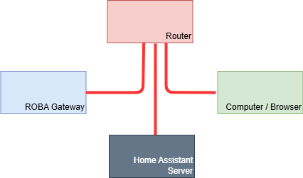
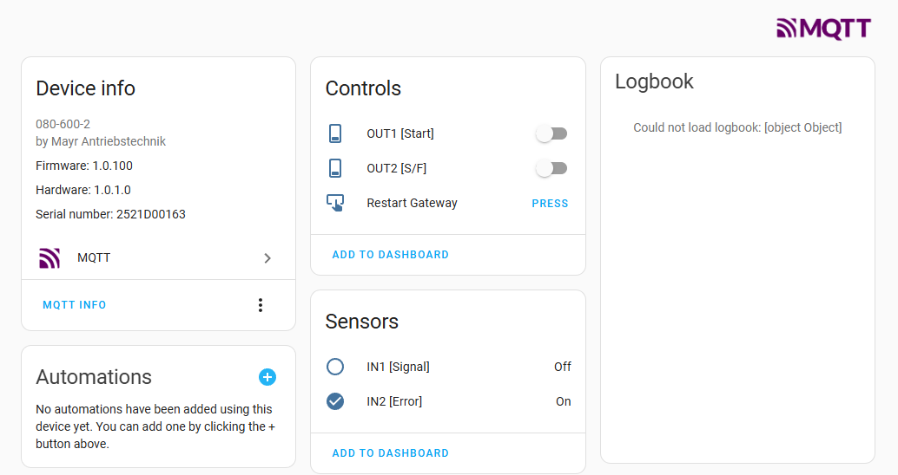

# Home Assistant Integration via MQTT

## Table of Contents

1. [Introduction](#introduction)
1. [Supported Versions](#supported-versions)
1. [Setup](#setup)
1. [Testing autodiscovery](#testing-autodiscovery)
1. [Limits of the example](#limits-of-the-example)

## Introduction

Home Assistant is an open-source home automation platform that focuses on privacy and local control. It allows you to control smart devices, automate tasks, and monitor your home environment through a user-friendly interface. Home Assistant supports MQTT Discovery, which enables automatic detection and configuration of the ROBA® Gateway and its connected ROBA® brake-checker.

## Supported Versions

This documentation was created using the following versions. It may work with other  versions, but this is not guaranteed. 

| Module                | Version     |
|:--------------        |:------------|
| Home Assistant      | 
Core 2024.12.0 Supervisor 2024.11.4  Operatingsystem 14.0 Frontend 20241127.4 
 |
| ROBA®-Gateway FW      | `1.0.0` |
| ROBA®-Gateway FS      | `1.0.0` |
| ROBA® brake-checker   | `4.0.0` |

## Setup

Connect your ROBA® Gateway with your local network over a router.

### Setup the Home Assistant

Configure the Home Assistant for MQTT service. Follow the official [Home Assistant documentation](https://www.home-assistant.io/integrations/mqtt).

Check your MQTT broker settings in Home Assistant (Settings -> Devices & Services -> MQTT -> Configure -> RE-CONFIGURE MQTT).  
Following settings should be used:

- Port: `1883`
- Enable discovery: `ON`
- Discovery prefix: `discovery`

You don't have to change Password and username. Home Assistant creates its own user for MQTT communication.

### Setup the ROBA® Gateway (MQTT Client)

Configure the ROBA® Gateway MQTT settings in the web interface like described in [MQTT Settings in ROBA® Gateway](../README.md#roba-gateway-mqtt-settings-for-the-examples).

If everything is set up correctly, the ROBA® Gateway should now connect to the MQTT broker.

## Testing Autodiscovery

Go to "Overview" in Home Assistant. Restart the ROBA® Gateway to force re-publishing of the discovery messages.
After a short moment, the ROBA® Gateway and the connected ROBA® brake-checker should appear automatically in the overview.

>ATTENTION:  
> The following example will set Output 0 of the ROBA®-Gateway to ON state.  
> Please ensure that nothing is connected electrically to Output 0 that could be damaged by this action.

Click on OUT1 On/Off button to toggle Output 0 of the ROBA® Gateway.

## Limits of the example

This example is intended to demonstrate the basic functionality of Home Assistant integration via MQTT Discovery. It does not cover all possible configurations or use cases. By now it is unclear, if there will be future support for MQTT discovery.

---

[Back to ROBA® Gateway main page](../../README.md) | [Back to MQTT overview](../README.md)