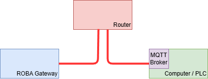
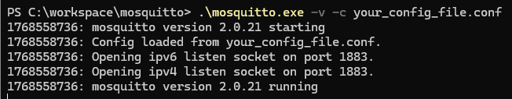
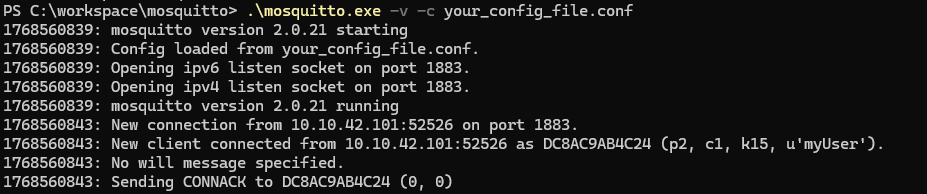
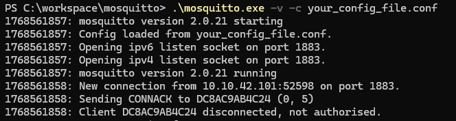
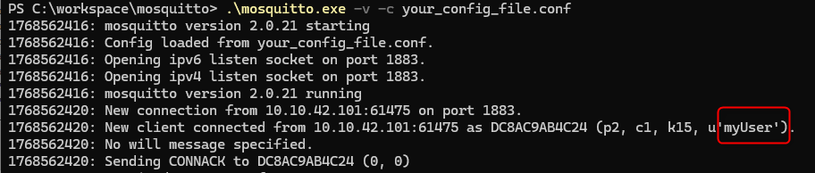
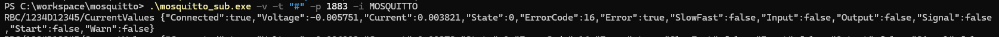
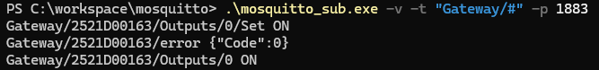

# Application Example using Mosquitto MQTT Broker

## Table of Contents

1. [Introduction](#introduction)
1. [Supported Versions](#supported-versions)
1. [Setup](#setup)
1. [Mosquitto subscribe](#mosquitto-subscribe)
1. [Mosquitto publish](#mosquitto-publish)
1. [Limits of the example](#limits-of-the-example)

## Introduction

This application example demonstrates how to set up a lightweight Mosquitto MQTT broker on your local machine and connect a ROBA® Gateway to it. It also shows how to verify the connection and interact with the ROBA® Gateway using MQTT publish and subscribe commands.

## Supported Versions

This documentation was created using the following versions. It may work with other  versions, but this is not guaranteed.

| Module                | Version     |
|:--------------        |:------------|
| ROBA®-Gateway FW      | `1.0.0`     |
| ROBA®-Gateway FS      | `1.0.0`     |
| ROBA® brake-checker   | `4.0.0`     |
| Mosquitto             | `2.0.21`    |

## Setup

### Mosquitto Installation

Install Mosquitto on your local machine. You can find installation instructions for various operating systems on the official [Mosquitto website](https://mosquitto.org/download/)

### Network Setup

Connect your ROBA® Gateway with your local network over a router.



### Setup the PC (MQTT Broker)

Set the network settings of your PC to DHCP. You can find the assigned IP address with bash command

```bash
ipconfig
```

which will return the assigned IP


In the installation directory of Mosquitto, add a new configuration file `your_config_file.conf` to listen to connections from outside. An example configuration could look like this:

```bash
listener 1883         # Default MQTT port, listens to all IP addresses
allow_anonymous true  # Allow anonymous connections (for testing purposes only)
```

Start your Mosquitto broker with the following command in the terminal. This selects the configuration file you created earlier and gives verbose output for debugging:

```bash
.\mosquitto.exe -v -c your_config_file.conf
```

You should see output similar to this, indicating that the broker is running and listening for connections:



### Setup the ROBA® Gateway

Configure the ROBA® Gateway MQTT settings in the web interface like described in [MQTT Settings in ROBA® Gateway](../README.md#roba-gateway-mqtt-settings-for-the-examples).

If everything is set up correctly, the ROBA® Gateway should now connect to the MQTT broker. You can verify this by checking the Mosquitto terminal output, which should show a new connection from the ROBA® Gateway's IP address.



 ## Broker with Authentication

Set up an authentication for your Mosquitto broker by creating a password file. You can do this using the `mosquitto_passwd` utility that comes with Mosquitto installation. More information on [Mosquitto Documentation](https://mosquitto.org/documentation/authentication-methods/).
Open a terminal and run following commands to restart the broker with password authentication:

```bash
.\mosquitto_passwd.exe -c myPasswordfile myUser
```
This command creates a new password file named `myPasswordfile` and adds a user `myUser`. You will be prompted twice to enter a password for the `myUser`. Please remember this password, as it will be needed for the ROBA® Gateway MQTT settings.

Next, modify your Mosquitto configuration file to include the password file and disable anonymous access.

```bash
listener 1883
allow_anonymous false
password_file myPasswordfile
```

Restart the Mosquitto broker to apply the changes.

Now, if not updated the `User` and `Password` in the ROBA® Gateway MQTT settings in the web interface, you will see a disconnection in the Mosquitto terminal output, as it does not authorize the connection attempt.



After updating the User and Password in the ROBA® Gateway MQTT settings to match the credentials set in the Mosquitto password file, the ROBA® Gateway should successfully connect to the broker again. You may need to restart the ROBA® Gateway for this.



## Mosquitto subscribe

To verify that the ROBA® Gateway is publishing messages to the MQTT broker, you can use the `mosquitto_sub` command-line tool to subscribe to all topics. Open a new terminal window and run the following command:

```bash
.\mosquitto_sub.exe -v -t "#" -p 1883 -h 10.10.41.19 -u "myUser" -P "password"
```

This command subscribes to all topics (`#`) on the broker running on port 1883 and prints the received messages to the terminal.

You should start seeing messages being published by the ROBA® Gateway, similar to the following output:



## Mosquitto publish

You can also publish messages to the ROBA® Gateway using the `mosquitto_pub` command-line tool. The following example shows how to switch Output 0 on the ROBA® Gateway. Please be sure, that you replace the `2521D00163` with the actual serial number of your ROBA® Gateway.

> ATTENTION!  
> This request will switch the output. Before proceeding, please make sure that no output is is connected electrically.

> ATTENTION!  
> some of the following steps require at least service level "Service", please log in with appropriate credentials in the Webinterface. See [Password generation](../README.md#password-generation) for more information.

```bash
#switch Output 0 ON
.\mosquitto_pub.exe -p 1883 -h 10.10.41.19 -t "Gateway/2521D00163/Outputs/0/Set" -m "ON" -u "myUser" -P "password"
#switch Output 0 OFF
.\mosquitto_pub.exe -p 1883 -h 10.10.41.19 -t "Gateway/2521D00163/Outputs/0/Set" -m "OFF" -u "myUser" -P "password"
```

You should see the corresponding messages in the `mosquitto_sub` terminal window, indicating that the output state has changed.



## Limits of the example

This example flow is intended for demonstration purposes only. For complete documentation please refer to the [ROBA®-Gateway Topic Documentation](../TopicDocumentation/).

---

[Back to main page](../../README.md) | [Back to MQTT overview](../README.md)
