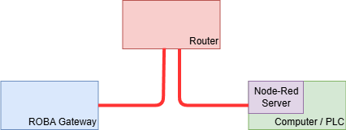
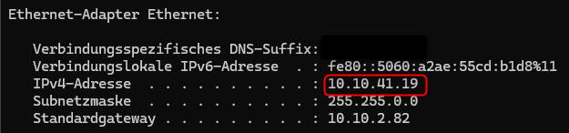
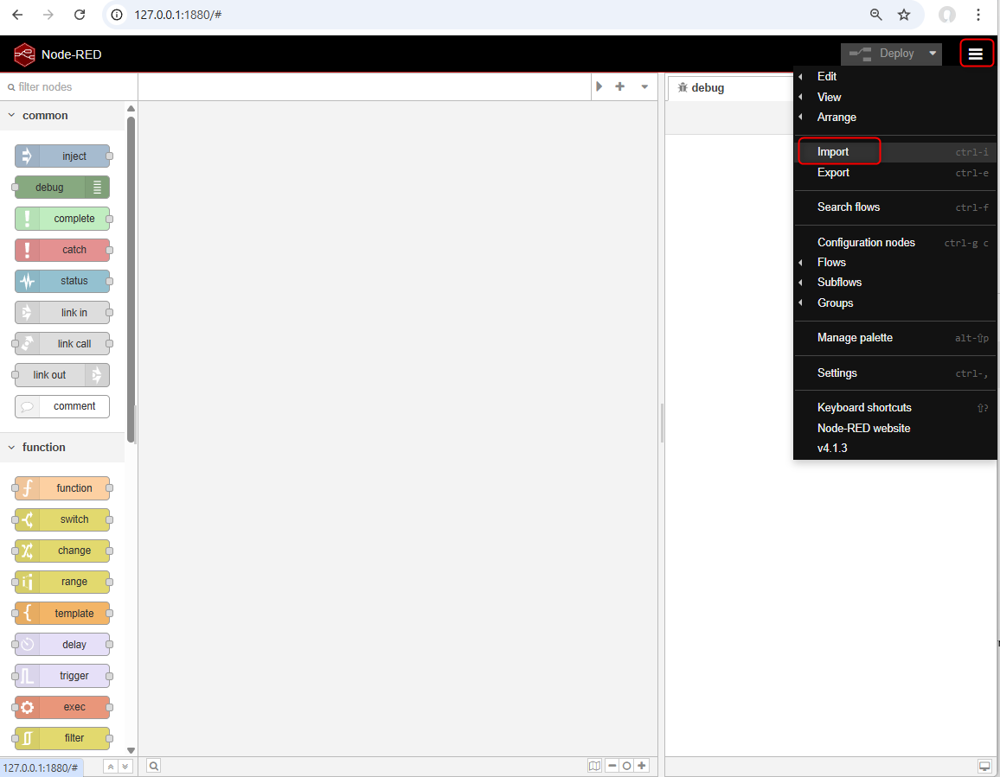
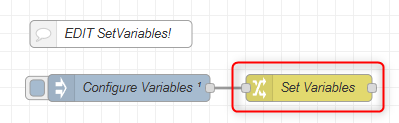
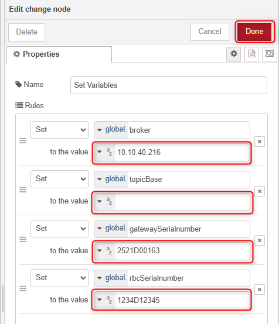
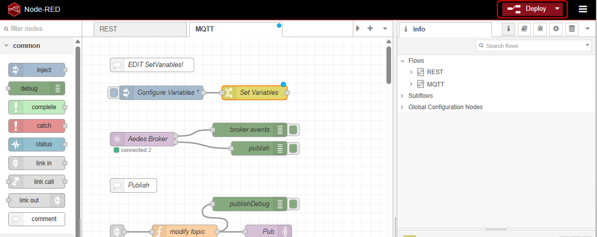
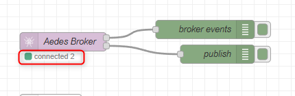
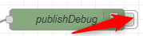

# ROBA® gateway MQTT Node-RED example

## Table of contents

1. [Introduction](#introduction)
1. [Supported Versions](#supported-versions)
1. [Setup](#setup)
1. [Testing the flow](#testing-the-flow)
1. [Limits of the example](#limits-of-the-example)

## Introduction

Node-RED is a powerful visual programming tool specifically designed for integrating hardware devices,  
APIs and online services. It allows you to create flows by connecting nodes, each of which performs a specific function.

In this flow, some available MQTT topics of the gateway are executed as examples.
Node-Red can be downloaded here [https://nodered.org/](https://nodered.org/).  
Please refer to the official Node-RED documentation for installation and setup instructions.

To get the example running, the module library [node-red-contrib-aedes-mqtt-broker](https://flows.nodered.org/node/node-red-contrib-aedes) is required!
Please follow the instructions on the Node-RED website.

## Supported Versions

This documentation was created using the following versions. It may work with other  versions, but this is not guaranteed.

| Module                             | Version  |
|:-----------------------------------|:---------|
| Node-RED                           | `4.1.3`  |
| node.js                            | `24.12.0`|
| node-red-contrib-aedes-mqtt-broker | `0.15.0` |
| ROBA® gateway FW                   | `1.0.0`  |
| ROBA® gateway FS                   | `1.0.0`  |
| ROBA® brake-checker®               | `4.0.0`  |

## Setup

Connect your gateway with your local network over a router.



### Setup the ROBA® gateway (MQTT Client)

Configure the gateway MQTT settings in the web interface like described in [MQTT Settings in ROBA® gateway](../README.md#roba-gateway-mqtt-settings-for-the-examples).

If everything is set up correctly, the gateway should now connect to the MQTT broker. You can verify this by checking the Mosquitto terminal output, which should show a new connection from the gateway's IP address.

## Starting node-red locally

Set the network settings of your PC to DHCP. You can find the assigned IP address with bash command

```bash
ipconfig
```

which will returned the assigned IP



To start Node-RED locally, open a terminal or command prompt and run the following command:

```bash
node-red
```

This will start the Node-RED server, and you can access the Node-RED editor by opening a web browser and navigating to `http://localhost:1880`.

To import the example flow, click on the menu button in the top right corner of the Node-RED editor, and select "Import".



You can now either copy and paste the [example flow JSON](flows.json) directly or upload the file using the file upload option.


In order to configure the flow according to the used system double click the "Set Variables" node to open the edit window.
The variables are automatically assigned, when deploying the flow.



Modify the broker variable to match the IP address of your MQTT broker (your PC) e.g. `10.10.40.216`.  
Modify the gatewaySerialnumber variable to match your gateway serial number e.g. `2521D00163`.  
Modify the rbcSerialnumber variable as well to match your brake-checker serial number e.g. `1234D12345`.  
The serial numbers both are case-sensitive.

If you are using a [topic prefix](../README.md#topic-prefix) set in the gateway MQTT settings, modify also the topicBase variable accordingly.
After you have finished, click `Done` to close the edit window and save the settings.



Now click `Deploy` to deploy the changes.



 If everything is set up correctly, the gateway should now connect to the MQTT broker. You can verify this by checking the number of clients connected to Aedes Broker, which should show "connected 2" (gateway and Node-RED). If the connection is not established, please restart the gateway and/or check your Firewall settings.



## Testing the flow

Once everything is set up, you can test the flow.

>ATTENTION:  
> The following example will set Output 0 of the gateway to ON state.  
> Please ensure that nothing is connected electrically to Output 0 that could be damaged by this action.

1. Open the debugger view by clicking on the bug icon in the top right corner of the Node-RED editor.
2. Click the inject button "Set Output 0 ON" to publish the command to the gateway via MQTT.
3. Now you should see the response from the gateway in the debug panel as well as measuring high state on Output 0.

You can enable more or less debug nodes in the flow to see more information about the MQTT messages being sent and received.



## Limits of the example

This example flow is intended for demonstration purposes only. For complete documentation please refer to the [CommunicationSpec](../../CommunicationSpec/README.md).

Feel free to modify and expand the flow according to your specific requirements and use cases.

---

[Back to ROBA® gateway main page](../../README.md) | [Back to MQTT overview](../README.md)
