# ROBA® gateway Bruno REST-API documentation

## Table of contents

1. [Introduction](#introduction)
1. [Supported Versions](#supported-versions)
1. [Open a collection in Bruno](#open-a-collection-in-bruno)
1. [Configure and environment](#configure-an-environment)
1. [Detailed description of the requests](#detailed-description-of-the-requests)
1. [Test the gateway connection](#test-the-gateway-connection)
1. [Send a PUT request with JSON body](#send-a-put-request-with-json-body)

## Introduction

Bruno is an opensource API client for exploring and testing APIs. It is a community driven project which is completely free, even for commercial use (at least at the time of writing this document)

Bruno can be downloaded here [https://www.usebruno.com/](https://www.usebruno.com/)

We have created a collection of requests for you in the Bruno application to ensure you a quick start.

Please follow these steps on the website to get started with the Bruno app. Once you have finished the installation, follow the instructions below to load and use the collection of requests.

## Supported Versions

This documentation was created using the following versions. It may work with other  versions, but this is not guaranteed.

| Module                | Version           |
|:--------------        |:------------------|
| Bruno Desktop         | `3.0.1` or higher |
| ROBA® gateway FW      | `1.0.0` or higher |
| ROBA® gateway FS      | `1.0.0` or higher |
| ROBA® brake-checker®  | `4.0.0` or higher |

## Open a collection in Bruno

Use one of the two buttons as shown in the image below to open an existing collection.

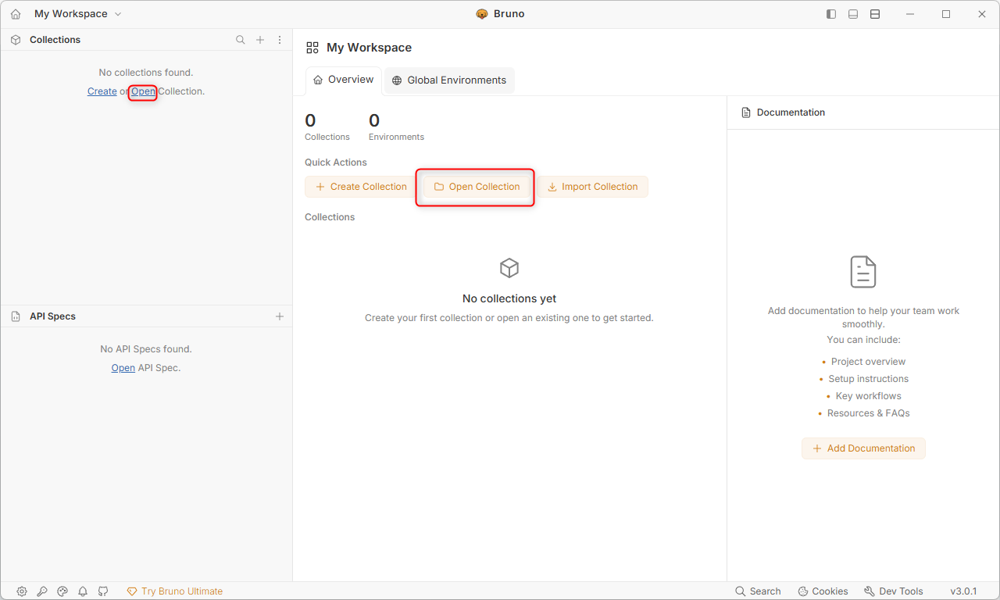

Navigate to the directory where the collection is stored. This should be usually `gateway-communication-examples/REST-API/Bruno/ROBA Gateway` and click on `Select Folder`.

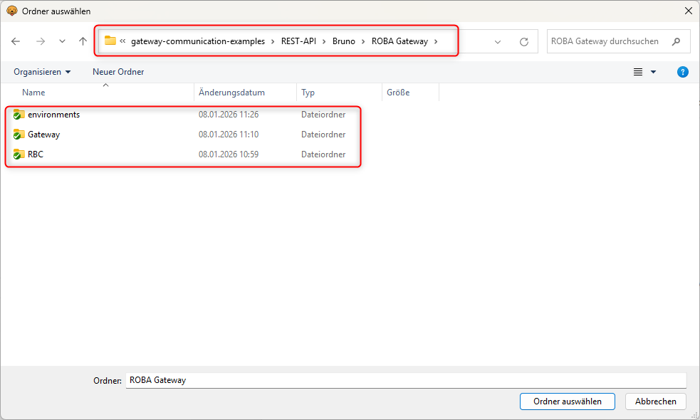

Once the collection has been opened you should see the collection in the Bruno collection view

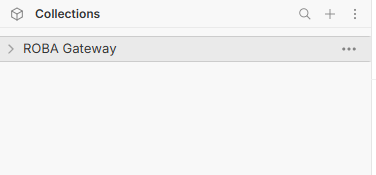

Expand the collection by clicking on `>`. The collection has been divided into two groups. The `Gateway` and the `RBC` group. Each group contains requests for the respective device. The `RBC` group contains requests for the brake-checker which communicates via an IrDA-Interface with the gateway.

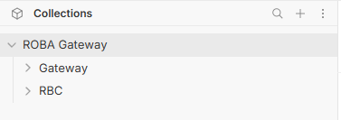

Expand each group by clicking on `>`.

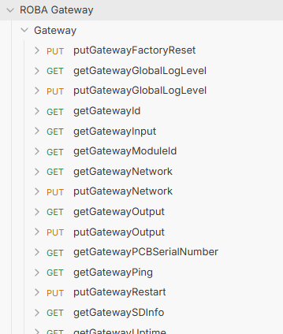

## Configure an environment

To be able to send requests to the gateway an environment must be selected. If you click on the `putGatewayFactoryReset` request you will see that `{{baseUrl}}` of the `PUT` request is highlighted in red. This means that the variable `baseUrl` is not found.

If you have a closer look at the top right of the app you will see the environment selection drop-down which shows us `No Environment` is selected.

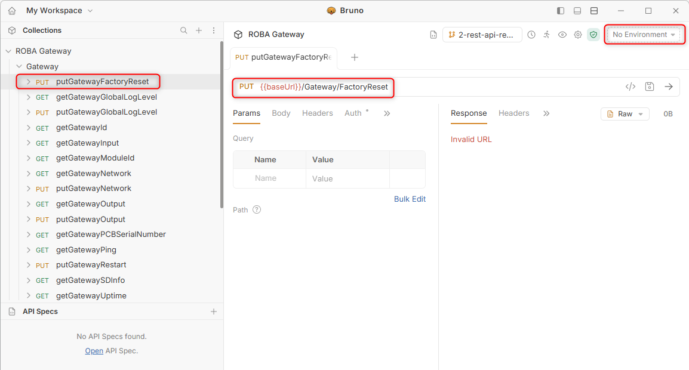

We have prepared two basic environments for you to start with.

- `customer` for `Customer` user access
- `service` for `Service` user access

To be able to use them, they first have to be configured correctly. Therefore click on the environment drop-down menu and select `Configure`.

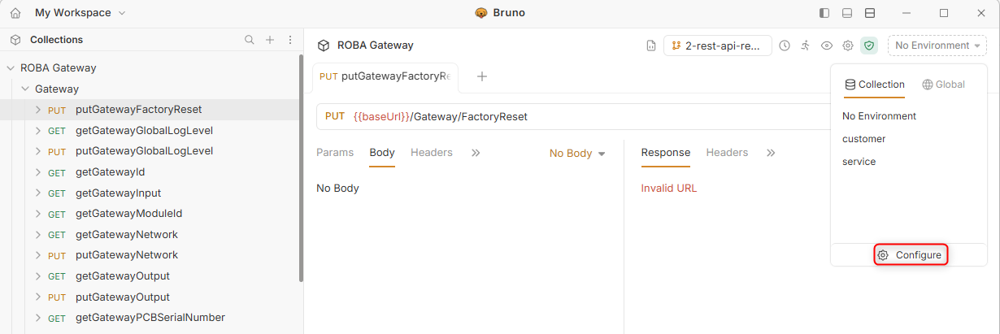

Now you can see two Environments listed. Select the `customer` environment to configure it for your network.

- Default IP Address of the gateway is `192.168.4.2`.
- Usernames have already been set to `Customer` and `Service` respectively.
- The password of the user levels is specific to your device's serial number. Please refer to [Password Section](../../README.md#password-generation) for more information.

After configuring the environment correctly, click on the environment drop-down menu again and select the `customer` environment to activate it.
Once the environment is selected and configured, the `baseUrl` variable should turn green.

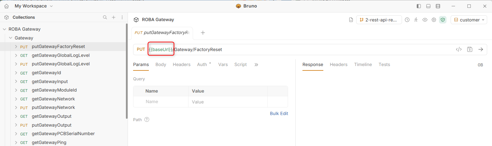

## Detailed description of the requests

Not every request is documented in the `Docs` tab. However, some of them are documented to give you an idea of how the requests are structured.
For detailed descriptions of all requests, please refer to the [CommunicationSpec](../../CommunicationSpec/README.md) section, which is kept up to date.

## Test the gateway connection

Now we are ready to test the connection to the gateway. Please connect your PC to the same network as the gateway before proceeding.

We highly recommend starting with `GET` requests to the gateway to get a feeling for how things work, if you have never worked with REST-API commands.

Select the `getGatewayId` request from the `Gateway` group on the left side and click the `Send` button (the little right arrow) or use shortcut `Ctrl + Enter` to send the request as shown in the image below.

If everything works as expected, you should see the `Response` from the gateway with a http status code `200 OK` as shown below.

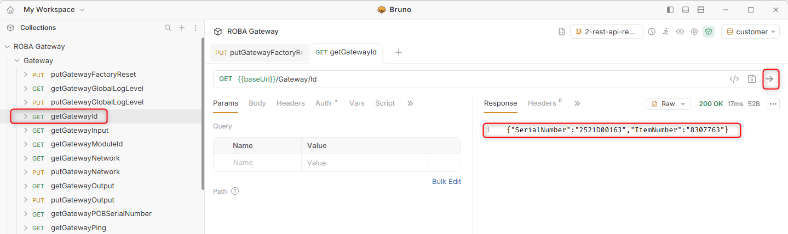

## Send a PUT request with JSON body

<!-- markdownlint-disable MD028-->
> ATTENTION!
> This request will switch the output. Before proceeding, please make sure that **no** output is is connected.

> NOTE!
> This request requires the user level `Customer`, otherwise you will receive the status code `401 Unauthorized`
<!-- markdownlint-enable MD028-->

Click on the `Environment` drop-down menu and select the `customer` environment.

Sending a `PUT` request is nearly the same like sending a `GET` request to the gateway. The only difference is that some of the requests need an additional JSON `Body` for the request. We already have prepared the JSON `Body` object so you only need to change the value for the request.

Please check out the `Docs` tab of the request for possible values for each request.

Select the `putGatewayOutput` request from the `Gateway` group on the left side and click on the `Params` tab as shown in the image below.

In section `Path` we have to set the channel we want to modify. In this example, we want to modify channel `0`, so please set the value to `0`.

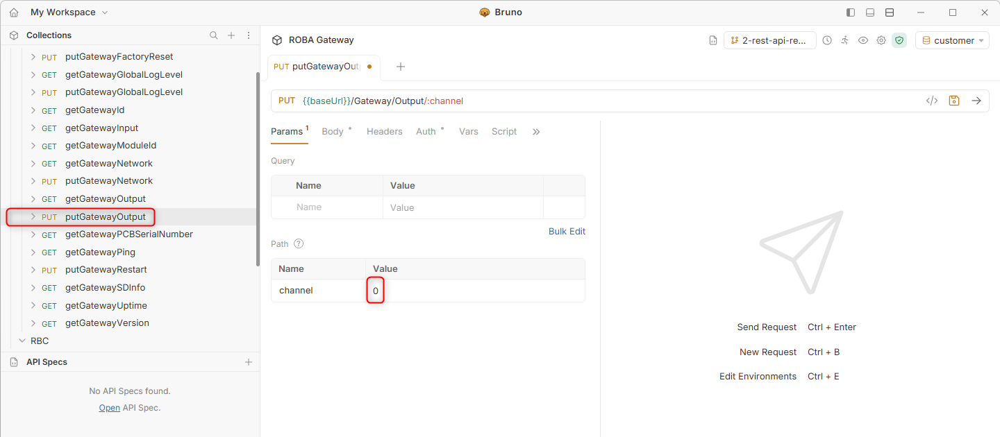

After selecting the channel, move to the `Body` tab. Set "value" to `true` to switch the output on.

```json
{
  "Value": 1
}
```

Send the request by clicking the `Send` button (the little right arrow) or use shortcut `Ctrl + Enter`. You should see the `Response` from the gateway with a http status code `204 No Content`.

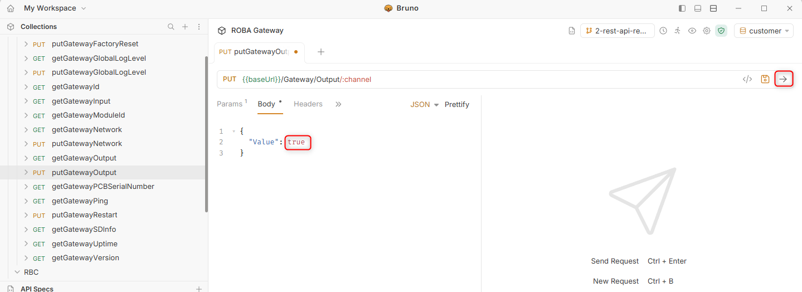

[Back to REST-API overview](../README.md)
