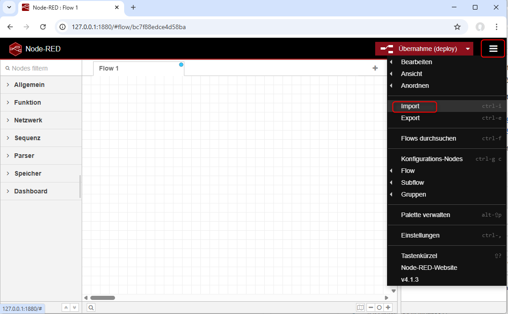
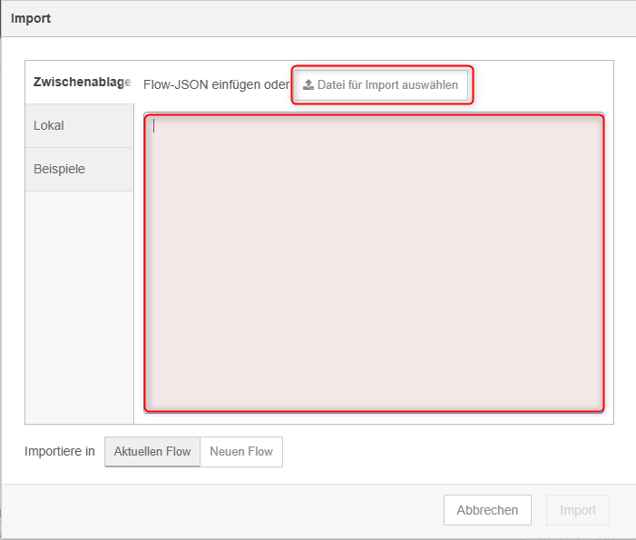
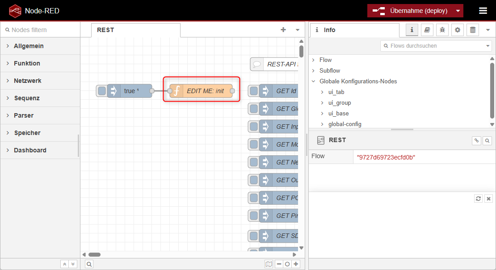
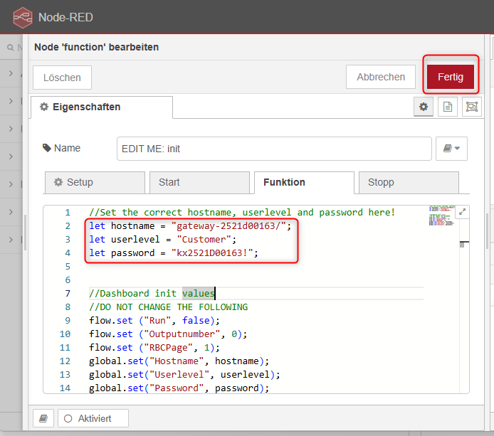
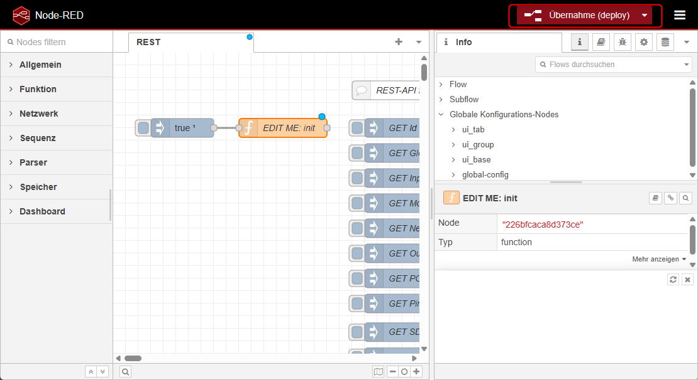
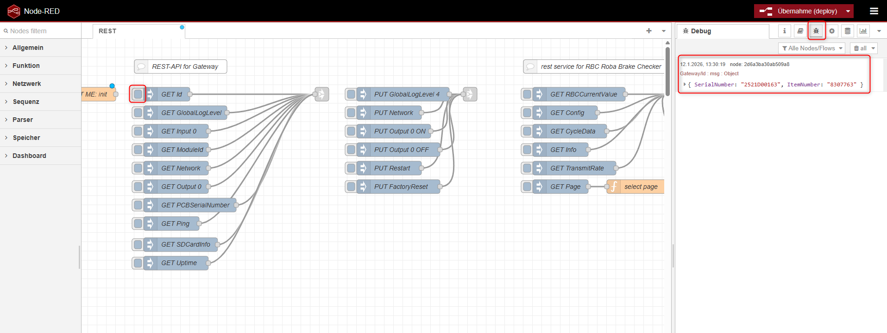
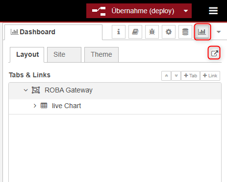
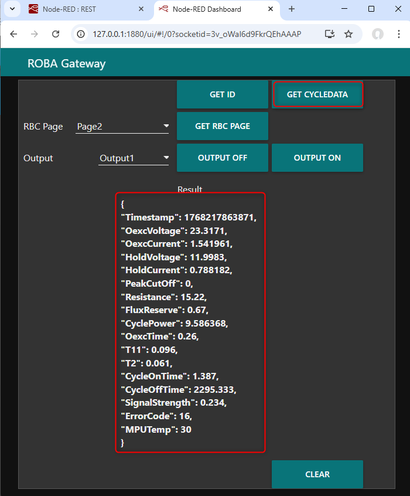

# ROBA®-Gateway Node-RED examples

## Table of contents
1. [Introduction](#introduction)
1. [Supported Versions](#supported-versions)
1. [Starting node-red locally](#starting-node-red-locally)
1. [Testing the flow](#testing-the-flow)
1. [Dashboard](#dashboard)
1. [Limits of the example](#limits-of-the-example)

## Introduction

Node-RED is a powerful visual programming tool specifically designed for integrating hardware devices,  
APIs and online services. It allows you to create flows by connecting nodes, each of which performs a specific function.


In this flow, some commands from the REST service of the ROBA®-Gateway are executed as examples,   
and a small dashboard is created for visualization.   
Node-Red can be downloaded here [https://nodered.org/](https://nodered.org/) 
Please refer to the official Node-RED documentation for installation and setup instructions.

To get the example running, the module library [node-red-dashboard](https://flows.nodered.org/node/node-red-dashboard) is required!
Please follow the instructions on the Node-RED website to install the dashboard module.

## Supported Versions

This documentation was created using the following versions. It may work with other  versions, but this is not guaranteed. 

| Module                | Version     |
|:--------------        |:------------|
| Node-RED              | `4.1.3` |
| node.js               | `18.17.1` |
| node-red-dashboard    | `3.6.6` |
| ROBA®-Gateway FW      | `1.0.0` |
| ROBA®-Gateway FS      | `1.0.0` |
| ROBA® brake-checker   | `4.0.0` |


## Starting node-red locally
To start Node-RED locally, open a terminal or command prompt and run the following command:

```bash
node-red
```

This will start the Node-RED server, and you can access the Node-RED editor by opening a web browser and navigating to `http://localhost:1880`.

To import the example flow, click on the menu button in the top right corner of the Node-RED editor, and select "Import".



You can now either copy and paste the [example flow JSON](flows.json) directly or upload the file using the file upload option.



In order to change the ROBA®-Gateway hostname and password double click the "EDIT ME: init"-function node. 



Modify the hostname to match your ROBA®-Gateway hostname. Please use the syntax `"gateway-"<serialnumber>"/"` e.g. `gateway-2521d00163/`. You can also use the IP address of the ROBA®-Gateway if preferred, e.g. `192.168.4.2` (default IP address), when you are using a direct Ethernet connection.

Modify also the user level and the password. For generating the password please refer to [Password Generation](../../Readme.md#password-generation).

After making the changes, click "Fertig" (top right corner) to close the edit window.




Click "Übernahme (deploy)" to deploy the changes.


## Testing the flow
Once everything is set up, you can test the flow.
1. Open the debugger view by clicking on the bug icon in the top right corner of the Node-RED editor.
2. Click the marked GET Id button to send a request to the ROBA®-Gateway.
3. Now you should see the response from the ROBA®-Gateway in the debug panel.



## Dashboard
To access the dashboard, open a web browser and navigate to `http://localhost:1880/ui`.
You can also click the dashboard icon and the link icon below it.


The dashboard provides a visual representation of the data received from the ROBA®-Gateway. You can also switch the outputs.

>ATTENTION!
>Before testing to switch the outputs, please make sure that **no** output of the ROBA®-Gateway is connected.

After clicking to `GET CYCLEDATA`, you should see the last cycle data of the brake, which is connected to ROBA® break-checker.



## Limits of the example

This example flow is intended for demonstration purposes only. It does definitely cover not all use cases and possibilities of the ROBA®-Gateway REST-API. For complete documentation please refer to the [ROBA®-Gateway REST API documentation](../API_Documentation/README.md).

Feel free to modify and expand the flow according to your specific requirements and use cases.

[Back to REST-API overview](../README.md)