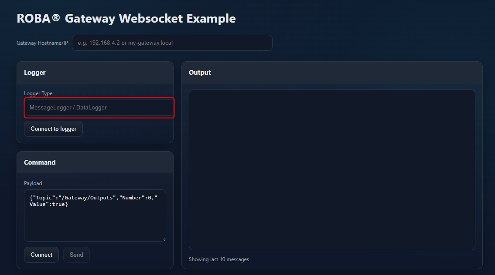
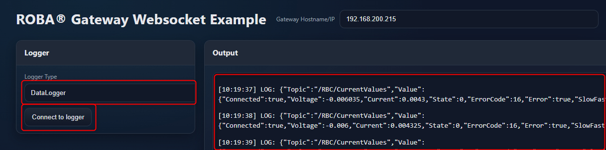
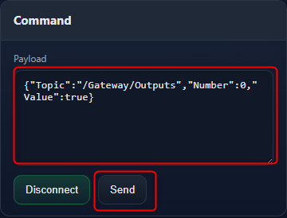

# HTML JavaScript WebSocket Example

## Table of contents

1. [Supported Versions](#supported-versions)
1. [Setup](#setup)
1. [Connecting to a logger](#connecting-to-a-logger)
1. [Send a command](#send-a-command)
1. [Limits of the example](#limits-of-the-example)

## Supported Versions

This documentation was created using the following versions. It may work with other  versions, but this is not guaranteed.

| Module                | Version     |
|:--------------        |:------------|
| Browser               | Latest      |
| ROBA® gateway FW      | `1.0.0`     |
| ROBA® gateway FS      | `1.0.0`     |
| ROBA® brake-checker®  | `4.0.0`     |

## Setup

Connect your gateway and power it on. Make sure that it is connected to the same network as your computer.
Open the [`index.html`](index.html) file in your web browser. You can do this by double-clicking the file or by dragging and dropping it into an open browser window.
Enter the IP address or hostname of your gateway in the input field provided. Check Ethernet settings of the gateway via the web interface if necessary.

> ATTENTION  
> If you are using the webinterface in parallel to this example, it will occupy two WebSocket client connection, one for MessageLogger, one for DataLogger. Since the gateway supports only 2 WebSocket connections per Loggertype simultaneously, only one additional connection per Loggertype is available for this example.

## Connecting to a logger

Refer to [Endpoints](../README.md#connection-endpoints) to choose an appropriate logger for your application.

Enter the logger endpoint in the Logger Type field.
Click `Connect to logger` to establish a WebSocket connection to the gateway.
Once connected, you can start receiving messages from the selected logger. The messages will be displayed in the Output box on the right.

## Send a command

If already a message logger connection is established, you can send commands to the gateway.
If not please click the `Connect` button in the Command box, which will open a connection to the Message Logger first.

<!-- markdownlint-disable MD028 -->
> ATTENTION  
> Some commands require a specific service level. For login to a specific service level the REST-API or the web interface can be used.

> ATTENTION  
> The following example will switch the output of the gateway.
 Please make sure that it is safe to do so in your application environment.
 <!-- markdownlint-enable MD028 -->

Enter the payload into the Payload field.
Click `Send` to send the command to the gateway.

## Limits of the example

This example is intended for demonstration purposes only. For complete documentation please refer to the [CommunicationSpec](../../CommunicationSpec/README.md).

---

[Back to main page](../../README.md) | [Back to Websockets overview](../README.md)
