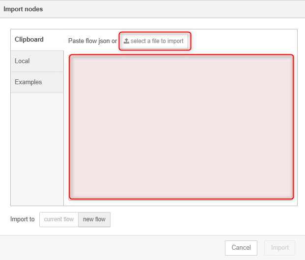
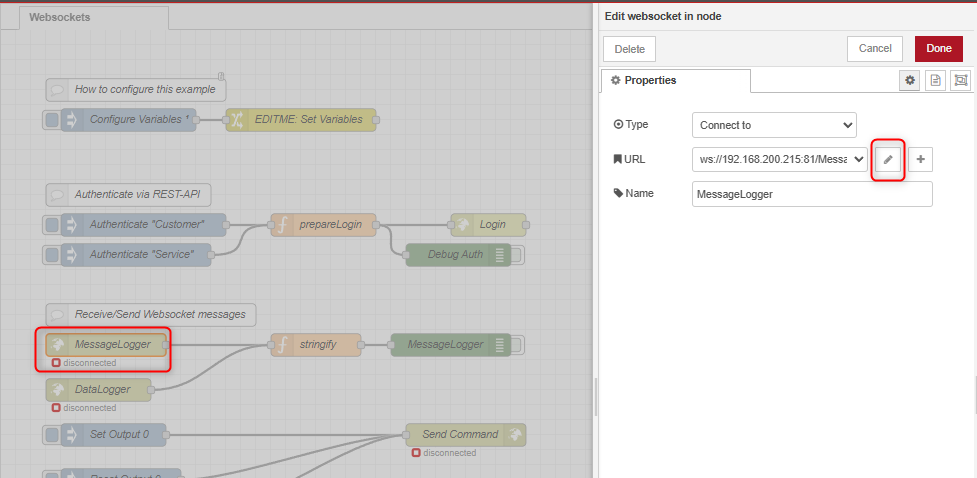
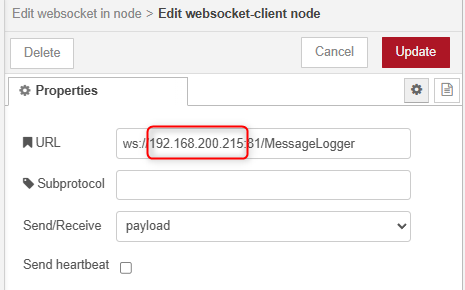
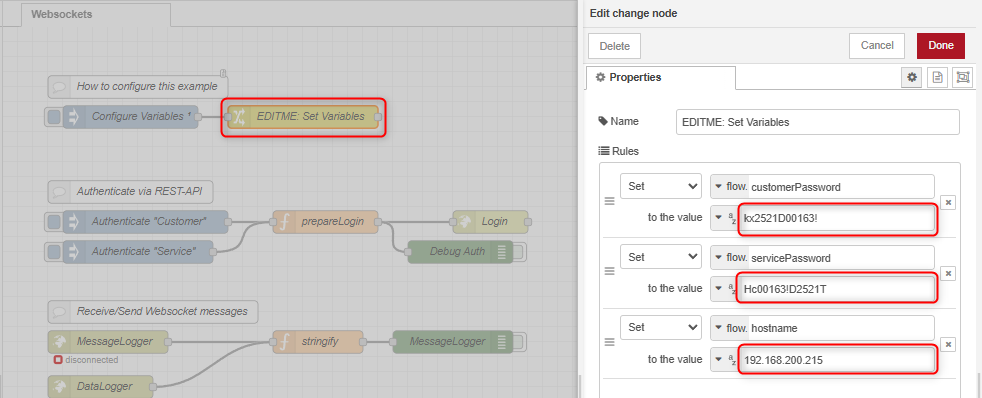
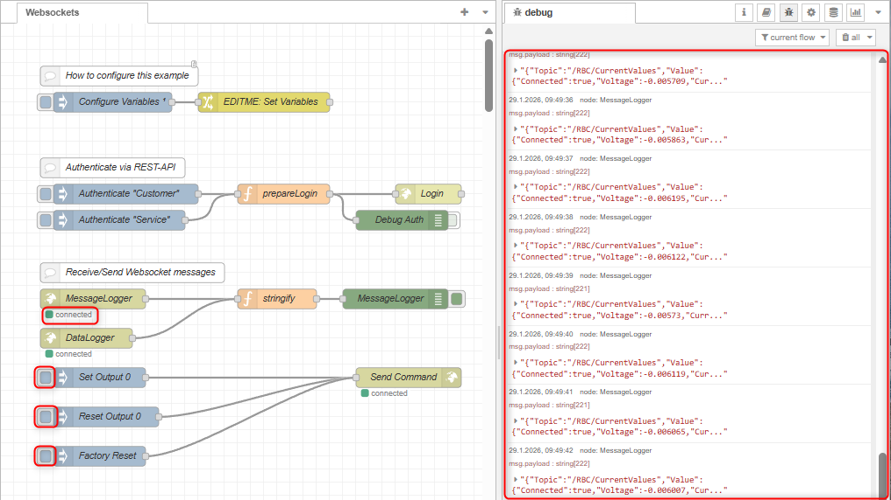

# NODE-RED WebSocket Example

## Table of contents
1. [Introduction](#introduction)
1. [Supported Versions](#supported-versions)
1. [Setup](#setup)
1. [Testing the flow](#testing-the-flow)
1. [Limits of the example](#limits-of-the-example)

## Introduction
Node-RED is a powerful visual programming tool specifically designed for integrating hardware devices,
APIs and online services. It allows you to create flows by connecting nodes, each of which performs a specific function.

In this flow, some available MQTT topics of the ROBA®-Gateway are executed as examples.
Node-Red can be downloaded here https://nodered.org/.
Please refer to the official Node-RED documentation for installation and setup instructions.

## Supported Versions

This documentation was created using the following versions. It may work with other  versions, but this is not guaranteed. 

| Module                | Version     |
|:--------------        |:------------|
| Node-RED              | `4.1.3` |
| node.js               | `18.17.1` |
| ROBA®-Gateway FW      | `1.0.0` |
| ROBA®-Gateway FS      | `1.0.0` |
| ROBA® brake-checker   | `4.0.0` |


## Setup

Connect your ROBA® Gateway and power it on. Make sure that it is connected to the same network as your computer.

To start Node-RED locally, open a terminal or command prompt and run the following command:

```bash
node-red
```

This will start the Node-RED server, and you can access the Node-RED editor by opening a web browser and navigating to `http://localhost:1880`.

To import the example flow, click on the menu button in the top right corner of the Node-RED editor, and select "Import".


You can now either copy and paste the [example flow JSON](flows.json) directly or upload the file using the file upload option.



Once the flow is imported, you should see it in the Node-RED editor.

In order to set NODE-RED to the IP of your ROBA® Gateway, double-click on the `MessageLogger` node to open its configuration.



 Open the configuration panel by clicking the pencil icon next to the `WebSocket URL` field and edit the URL to point to your ROBA® Gateway.



Do the same for the `DataLogger` node.
The `Send Command` node does not require any changes, as it uses same websocket connection as the `MessageLogger` node.

Additionally, make sure that your ROBA® Gateway is authenticated for a certain userlevel, otherwise the WebSocket commands in this example will not work. You can do this by logging into the web interface of the ROBA® Gateway or the provided authentication mechanism in the flow. Therefore, double-click on the `EDITME: Set Variables` and set the correct hostname and password for your ROBA® Gateway. For detailed description of the password, please refer to [Password Section](../../README.md#password-generation).



> ATTENTION!  
> If you are using the webinterface in parallel to this example, it will occupy two WebSocket client connection, one for MessageLogger, one for DataLogger. Since the ROBA® Gateway supports only 2 WebSocket connections per Loggertype simultaneously, only one additional connection is available for this example.

## Testing the flow
Once everything is set up, you can test the flow.
1. Click `<Deploy>` in the top right corner.
2. Open the debugger view by clicking on the bug icon in the top right corner of the Node-RED editor.

If the Websocket connections to the ROBA® Gateway are established successfully, you should start seeing messages in the debug panel.
Additionally the small dots below the `MessageLogger` and `DataLogger` nodes should turn green, indicating an active connection.

>ATTENTION!  
>Before testing to switch the outputs, please make sure that **no** output of the ROBA®-Gateway is connected.

If authenticated correctly with at least as `Customer` , you can now switch the outputs of the ROBA® Gateway by clicking the buttons below the `Set Output 0` and `Reset Output 0` nodes.

For FactoryReset button, you need to be authenticated as `Service`.



## Limits of the example

This example is intended for demonstration purposes only. For complete documentation please refer to the Websocket [Message Documentation](../Message_Documentation/Gateway_Messages.md).

---

[Back to main page](../../README.md) | [Back to Websockets overview](../README.md)